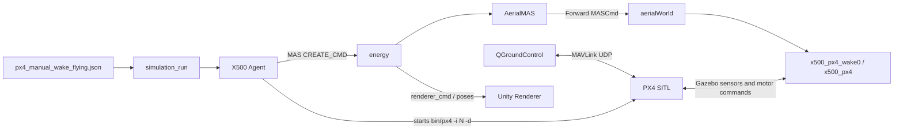

# Technical Report: PX4 Integration Into LOTUSim Generic Scenario

## 1. Purpose

This report describes how PX4 SITL is integrated into LOTUSim Generic Scenario for the X500 aerial drone workflow.

The goal of the integration is to let an X500 drone spawned from a Generic Scenario configuration be flown by PX4 SITL, from QGroundControl or from a mission task, while keeping LOTUSim's separated-world architecture.

The resulting behavior is:

```text
Generic Scenario launches the simulation
X500 agent is spawned in the scenario world (energy)
AerialMAS forwards the real airframe to aerialWorld and keeps a mirror in energy
PX4 SITL starts and attaches to the airframe in aerialWorld
QGroundControl, or the px4_offboard_patrol task, talks to PX4 over MAVLink
PX4 receives Gazebo sensor data
PX4 publishes motor commands back to Gazebo
The drone moves, and Unity follows the mirror
```

The user-facing guide (installing PX4, enabling it on an agent, flying it) is `doc/PX4_DRONES.md` in Generic Scenario. This page explains how the pieces are wired.

## 2. Repositories Involved

The integration spans two repositories plus PX4 itself.

### LOTUSim Core

Path:

```text
$LOTUSIM_PATH
```

Responsibilities:

- Gazebo worlds
- Gazebo models
- MultiAgentSystem plugin
- AerialMAS forwarding plugin
- RenderPlugin and Unity-facing ROS messages
- Gazebo physics, sensor, and motor plugin support

### LOTUSim Generic Scenario

Path:

```text
$LOTUSIM_SCENARIO_WS
```

Responsibilities:

- scenario configuration
- agent creation
- X500 agent behavior
- PX4 process startup
- Unity executable startup
- scenario launch workflow

### PX4-Autopilot

Path:

```text
$PX4_AUTOPILOT_PATH   (default: $HOME/PX4-Autopilot)
```

Responsibilities:

- PX4 SITL flight controller
- Gazebo bridge module
- MAVLink server
- estimator, sensors, arming, and motor output logic

PX4 is used as an external dependency, built once with `make px4_sitl`. No PX4 source code changes are required.

## 3. Why A Separate Aerial World Is Kept

The scenario world, `energy`, runs surface and underwater simulation. It is designed around LOTUSim's naval simulation stack, including xdyn.

PX4-controlled drones need a different simulation setup:

- real gravity
- higher physics update rate
- PX4-compatible sensor topics
- multicopter motor plugins
- stable model naming
- Gazebo world/model topics that PX4 expects

For this reason, every run launches two worlds:

```text
energy.world
  scenario/render world (the scenario JSON's world_file)

aerialWorld.world
  real aerial physics world for PX4 drones
```

`aerialWorld` is not a scenario choice: `simulation_runner.build_launch_command()` always launches it, from the hardcoded `utils.AERIAL_WORLD_FILE`. The name `aerialWorld` must agree everywhere it appears (the world SDF, the `<aerial_namespace>` of `AerialMAS`, and the Aerial `physics_engine_interface` block the agent SDK emits). A mismatch does not raise an error; the aerial MAS just reports "not available".

## 4. High-Level Architecture



## 5. Scenario Configuration

PX4 is enabled per agent. Example scenarios:

```text
src/simulation_run/config/wind_wake_examples/px4_manual_wake_flying.json
src/simulation_run/config/wind_wake_examples/px4_offboard_patrol_test.json
src/simulation_run/config/wind_wake_examples/wake_crossing_demo.json
```

Relevant fields:

```json
{
  "world_file": "energy.world",
  "agents": [
    {
      "id": "x500_px4",
      "class": "X500",
      "spawn": { "x": 20, "y": 30, "z": 0, "yaw": 0.0 },
      "px4": true,
      "px4_control": "manual",
      "sdf_file": "model.sdf",
      "xdyn": false
    }
  ],
  "renderer_unity": true
}
```

The important field is:

```json
"px4": true
```

It makes the X500 agent spawn the PX4-capable Gazebo model and start PX4 SITL once the spawn is confirmed. `spawn.z` must be `0` on a PX4 agent: an unarmed multirotor produces no thrust, so a drone spawned in the air falls before PX4 has booted and the impact corrupts EKF2's estimates. `px4_control` (`manual` or `offboard`) is descriptive; the attached mission task is what drives the vehicle.

## 6. Launch Flow

The user starts the scenario with:

```bash
./src/simulation_run/executable/scenario_launch.sh \
  --config wind_wake_examples/px4_manual_wake_flying.json
```

The launch script performs the following steps:

1. Resolves `PX4_AUTOPILOT_PATH`.
2. Starts the ROS TCP endpoint for Unity.
3. Starts the Unity executable if `renderer_unity` is true.
4. Starts the `simulation_run` ROS 2 entry point (shard 0, plus more shards with `--shards`).
5. `simulation_run` launches the aerial world, then the scenario world.
6. `AgentsManager` creates and spawns the configured X500 agent.
7. When the spawn is confirmed, the X500 agent starts PX4 SITL.

The two worlds are launched as:

```text
mise run --cd $LOTUSIM_PATH sim aerialWorld.world
mise run --cd $LOTUSIM_PATH sim energy.world
```

(`lotusim run <world>` when mise is not installed.) The aerial world is launched first so the scenario world's `AerialMAS` finds `/aerialWorld/mas_cmd` when it loads.

## 7. Agent Creation And PX4 Flag

The agent manager reads each agent entry from the scenario configuration, in:

```text
src/simulation_run/simulation_run/agents_manager.py
```

`AgentsManager._px4_kwargs()` reads `px4` and `px4_control` and forwards them as `px4_enabled` / `px4_control`, but only to agent classes whose constructor declares those parameters. Every other agent type is unaffected.

The instance name is the entry's `id` followed by its index:

```text
x500_px4  ->  x500_px40
```

That name becomes the Gazebo model instance name and the PX4 attachment target.

## 8. X500 PX4 Behavior

The PX4 integration lives in:

```text
src/lotusim_sdk/lotusim_sdk/agents/entity/physical/x500.py
```

When PX4 is enabled:

```python
if self.px4_enabled:
    self.model_name = self.PX4_MODEL_NAME   # "x500_px4"
```

The renderer type stays `x500`, which gives an intentional split:

```text
Gazebo/PX4 model: x500_px4
Unity visual model: x500
Spawned instance: x500_px40
```

Unity already knows how to render `x500`, while Gazebo/PX4 needs the `x500_px4` model with its sensors and motor plugins.

PX4 is started from `confirm_spawn()`, the signal fired by both spawn paths once the host has assigned the entity's final name:

```python
def confirm_spawn(self, assigned_name):
    super().confirm_spawn(assigned_name)
    if self.px4_enabled and self.px4_process is None:
        self._start_px4_sitl()
```

`_start_px4_sitl()` runs the prebuilt PX4 binary directly, in daemon mode (no interactive `pxh>` shell):

```python
cmd = [px4_binary, "-i", str(instance), "-d"]
# px4_binary = $PX4_AUTOPILOT_PATH/build/px4_sitl_default/bin/px4
```

with this environment:

```python
env["PX4_GZ_MODEL_NAME"] = self.agent_name
env["PX4_GZ_WORLD"] = gz_world          # "aerialWorld"
env["PX4_SIM_MODEL"] = "gz_x500"
env.setdefault("GZ_IP", "127.0.0.1")
```

For the first drone:

```bash
PX4_GZ_MODEL_NAME=x500_px40
PX4_GZ_WORLD=aerialWorld
```

This is how PX4 knows which existing Gazebo model and world to attach to.

Other details of the launch:

- Each PX4 process gets its own instance number `-i N` (`X500._next_px4_instance`), so `MAV_SYS_ID` and the MAVLink ports differ and QGroundControl sees distinct vehicles. With several shards, each shard numbers its instances from `LOTUSIM_PX4_INSTANCE_BASE`.
- Each instance runs in its own working directory, `build/px4_sitl_default/instance_N`, so EEPROM, parameters and logs never collide. A stale `dataman` file is removed first, otherwise PX4 replays the previous mission.
- A leftover PX4 process holding the same instance lock is killed first.
- Inside the nix devshell, the nix entries are removed from `LD_LIBRARY_PATH`, `PATH` and `GZ_CONFIG_PATH`, so the system-built PX4 finds the system gz libraries it was linked against.
- The console output goes to `scenario_logs/<timestamp>/px4_sitl_<agent_name>.log`.
- `X500.destroy_node()` terminates the PX4 process when the agent is torn down.

## 9. MAS Spawn Command

All agents are spawned through the LOTUSim MAS command actions. By default, `AgentsManager` sends every CREATE_CMD of a spawn wave in one `MASCmdArray` goal (`send_batch_mas_cmd`, in `src/lotusim_sdk/lotusim_sdk/agents/entity/__init__.py`):

```text
/energy/mas_cmd_array
```

When the host has no `mas_cmd_array` server, each agent sends its own command on:

```text
/energy/mas_cmd
```

The X500 registers under the scenario's own world, like any other entity. It must not register directly under `aerialWorld`: that would skip the forward and mirror steps, and the drone would never appear in the scenario world or in Unity.

For the PX4 X500 case, the command carries:

```text
model_name  = x500_px4
sdf_file    = model.sdf
vessel_name = x500_px40
sdf_string  = <lotus_param> with an Aerial physics_engine_interface block
```

## 10. Aerial Forwarding Bridge

The scenario world file is:

```text
assets/worlds/energy.world
```

It contains:

```xml
<plugin filename="aerial_demo_mas" name="lotusim::gazebo::AerialMAS">
    <aerial_namespace>aerialWorld</aerial_namespace>
</plugin>
```

This tells the scenario world where aerial spawn commands should be forwarded.

The forwarding logic is in:

```text
systems/aerial_demo_entity_manager/src/aerial_mas.cpp
```

`AerialMAS` inherits from `MultiAgentSystem`. It spawns the entity in the scenario world as usual, and forwards the command to:

```text
/aerialWorld/mas_cmd
```

It forwards only the agents whose `<aerial>` physics block is wired as `<connection_type>ROS2</connection_type>` (`mirrorsFromAerialWorld`), meaning "the host mirrors my pose from the aerial world". Surface and underwater agents are never forwarded: the aerial world could not handle their hull collision meshes.

So the spawn path is:

```text
Generic Scenario X500 agent
  -> /energy/mas_cmd_array (or /energy/mas_cmd)
  -> AerialMAS
  -> /aerialWorld/mas_cmd
  -> x500_px40 created in aerialWorld
```

The pose of the real drone then flows back into the mirror in `energy`; see `PX4_Flow_Diagram.md`.

## 11. PX4-Compatible Aerial World

The aerial world is:

```text
assets/worlds/aerialWorld.world
```

Important world settings:

```xml
<world name="aerialWorld">
  <gravity>0 0 -9.8066</gravity>

  <physics type="ode">
    <max_step_size>0.002</max_step_size>
    <real_time_update_rate>500</real_time_update_rate>
    <real_time_factor>1</real_time_factor>
  </physics>
</world>
```

These settings are needed because PX4 expects a real flight environment rather than the zero-gravity naval scenario world.

The aerial world also loads:

- IMU system
- magnetometer system
- air pressure system
- sensors system
- navsat system
- user commands system
- physics system
- MultiAgentSystem
- scene broadcaster
- wind regions plugin

## 12. PX4-Compatible X500 Model

The PX4 model is:

```text
assets/models/x500_px4/model.sdf
```

It contains the simulated sensors PX4 requires:

```xml
<sensor name="imu_sensor" type="imu">
<sensor name="air_pressure_sensor" type="air_pressure">
<sensor name="magnetometer_sensor" type="magnetometer">
<sensor name="navsat_sensor" type="navsat">
```

It also contains four Gazebo multicopter motor plugins:

```xml
<plugin filename="gz-sim-multicopter-motor-model-system"
  name="gz::sim::systems::MulticopterMotorModel">
  <commandSubTopic>command/motor_speed</commandSubTopic>
</plugin>
```

These plugins apply motor forces to the drone when PX4 publishes actuator commands.

## 13. PX4-Gazebo Communication

No custom PX4 bridge was written for this integration.

PX4 already provides the bridge in:

```text
$PX4_AUTOPILOT_PATH/src/modules/simulation/gz_bridge
```

The bridge subscribes to Gazebo topics using the world and model names passed by the integration.

For the first drone, PX4 subscribes to topics like:

```text
/world/aerialWorld/clock
/world/aerialWorld/pose/info
/world/aerialWorld/model/x500_px40/link/base_link/sensor/imu_sensor/imu
/world/aerialWorld/model/x500_px40/link/base_link/sensor/air_pressure_sensor/air_pressure
/world/aerialWorld/model/x500_px40/link/base_link/sensor/magnetometer_sensor/magnetometer
/world/aerialWorld/model/x500_px40/link/base_link/sensor/navsat_sensor/navsat
```

PX4 publishes motor commands to:

```text
/x500_px40/command/motor_speed
```

PX4's bridge converts Gazebo sensor messages into PX4 internal sensor messages, then PX4's estimator and controller produce actuator outputs. Those outputs are published back to Gazebo as motor speed commands.

## 14. MAVLink: QGroundControl And Offboard Control

Nothing talks to PX4 through LOTUSim: PX4 is commanded over MAVLink only.

- **QGroundControl** connects automatically to any PX4 SITL instance on `localhost:14550` (`px4_control: "manual"`).
- **The `px4_offboard_patrol` mission task** (`src/lotusim_sdk/lotusim_sdk/tasks/px4_offboard_patrol.py`) connects on UDP port `14540 + instance`, arms the vehicle, takes off, switches to OFFBOARD and streams position setpoints through a waypoint list (`px4_control: "offboard"`).

The control path is:

```text
QGroundControl or px4_offboard_patrol
  -> MAVLink
  -> PX4 SITL
  -> Gazebo motor command topic
  -> x500_px40 motor plugins
  -> drone moves
```

The feedback path is:

```text
Gazebo x500_px40 sensors
  -> PX4 gz_bridge
  -> PX4 estimator/state
  -> MAVLink telemetry
  -> QGroundControl or px4_offboard_patrol
```

## 15. Why PX4 Integration Appears Small

The amount of custom integration code is small because the heavy work already exists in PX4 and Gazebo.

PX4 already provides:

- SITL
- flight controller
- estimator
- MAVLink
- Gazebo bridge
- actuator output interface

Gazebo already provides:

- physics simulation
- sensor simulation
- motor plugins
- topic transport

LOTUSim Generic Scenario mainly provides:

- spawn lifecycle
- correct world selection
- correct model selection
- PX4 process launch, one instance per drone
- correct environment variables
- Unity rendering compatibility

The integration is therefore mostly about making names, topics, worlds, and process timing match.

## 16. Where The Integration Lives

### Generic Scenario

- PX4-enabled example scenarios in `src/simulation_run/config/wind_wake_examples/`
- `AgentsManager._px4_kwargs()` in `agents_manager.py`
- PX4 startup and teardown in `x500.py` (`confirm_spawn`, `_start_px4_sitl`, `destroy_node`)
- `x500_px4` chosen as the Gazebo model when `px4: true`, Unity renderer type kept as `x500`
- PX4 environment variables: `PX4_GZ_MODEL_NAME`, `PX4_GZ_WORLD`, `PX4_SIM_MODEL`, `GZ_IP`
- the `px4_offboard_patrol` task
- `PX4_AUTOPILOT_PATH` resolution in `scenario_launch.sh`
- the user guide, `doc/PX4_DRONES.md`

### LOTUSim Core

- `aerialWorld.world`
- the `AerialMAS` plugin in `energy.world`
- the `x500_px4` Gazebo model
- PX4-compatible sensor and motor plugin setup

## 17. Summary

PX4 is integrated into LOTUSim by keeping the separate aerial-world design and adding a PX4-aware X500 workflow.

The main integration points are:

- Generic Scenario spawns an X500 agent in the scenario world.
- The X500 agent selects `x500_px4` as the Gazebo model when PX4 is enabled.
- The scenario world's `AerialMAS` forwards the airframe to `aerialWorld` and keeps a mirror for Unity.
- PX4 SITL is started on spawn confirmation, with the correct world and model environment variables.
- PX4's existing Gazebo bridge handles sensor and actuator communication.
- QGroundControl or the `px4_offboard_patrol` task controls PX4 through MAVLink.
